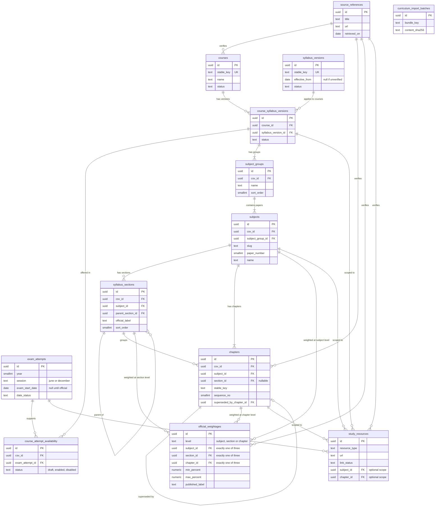
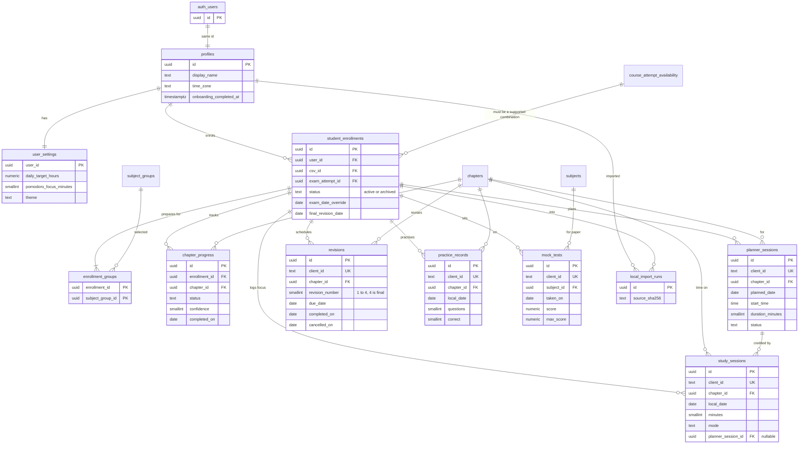

# Database ERD (design only)

Status: proposal. Companion to `database-schema.md`, which has the full column lists, constraints and lifecycle rules.

How to read it:

- Crow's-foot cardinality. `||` means exactly one, `o|` zero or one, `|{` one or many, `o{` zero or many.
- `csv_id` is shorthand for `course_syllabus_version_id`. It is repeated on most tables because **composite foreign keys use it to prove a row's parent is in the same course-and-syllabus scope**. Those composite keys cannot be drawn in Mermaid; they are listed under the diagrams.
- Only key columns and the columns needed to understand a relationship are shown.

## 1. Shared curriculum



`curriculum_import_batches` has no relationships. It is an audit log of applied seed bundles.

Composite foreign keys that guarantee scope (not drawn above):

| Child | Composite key | Parent | Guarantees |
| --- | --- | --- | --- |
| `subjects` | `(subject_group_id, csv_id)` | `subject_groups (id, csv_id)` | a subject's group is in the same course and syllabus |
| `syllabus_sections` | `(subject_id, csv_id)` | `subjects (id, csv_id)` | same scope |
| `syllabus_sections` | `(parent_section_id, subject_id)` | `syllabus_sections (id, subject_id)` | a parent section is in the same subject |
| `chapters` | `(subject_id, csv_id)` | `subjects (id, csv_id)` | same scope |
| `chapters` | `(section_id, subject_id)` | `syllabus_sections (id, subject_id)` | a chapter's section is in the same subject |
| `chapters` | `(superseded_by_chapter_id, csv_id)` | `chapters (id, csv_id)` | replacement is in the same scope |
| `official_weightages` | one composite key per level | `subjects`, `syllabus_sections`, `chapters` on `(id, csv_id)` | the target is in the same scope |
| `study_resources` | `(subject_id, csv_id)`, `(chapter_id, csv_id)` | `subjects`, `chapters` | resource scope is consistent |

## 2. Student data and its link to curriculum



Composite foreign keys that guarantee ownership and scope (not drawn above):

| Child | Composite key | Parent | Guarantees |
| --- | --- | --- | --- |
| `enrollment_groups` | `(enrollment_id, user_id, csv_id)` | `student_enrollments (id, user_id, csv_id)` | the group row belongs to that user's enrolment |
| `enrollment_groups` | `(subject_group_id, csv_id)` | `subject_groups (id, csv_id)` | the group is in the enrolment's syllabus |
| `student_enrollments` | `(csv_id, exam_attempt_id)` | `course_attempt_availability (csv_id, exam_attempt_id)` | only a supported combination can be enrolled |
| `chapter_progress`, `planner_sessions`, `study_sessions`, `revisions`, `practice_records` | `(enrollment_id, user_id, csv_id)` | `student_enrollments (id, user_id, csv_id)` | **a row cannot reference another user's enrolment, and carries the enrolment's syllabus scope** |
| the same five tables | `(chapter_id, csv_id)` | `chapters (id, csv_id)` | **the chapter is in the enrolment's syllabus** |
| `mock_tests` | `(subject_id, csv_id)` | `subjects (id, csv_id)` | the paper is in the enrolment's syllabus |
| `study_sessions` | `(planner_session_id, user_id)` | `planner_sessions (id, user_id)` | a focus record can only credit the same user's planned session |

Together, `user_id` plus `csv_id` on every personal row mean that even if a row-level-security policy were mistakenly loosened, the **foreign keys alone** would still prevent cross-user and cross-syllabus references.

## 3. What each personal row points at

```text
auth.users ──1:1── profiles ──1:1── user_settings
                      │
                      └─1:n─ student_enrollments ──n:1── course_attempt_availability
                                  │                              │ (csv_id, exam_attempt_id)
                                  ├── enrollment_groups ──n:1── subject_groups
                                  ├── chapter_progress ─────┐
                                  ├── planner_sessions ─────┤
                                  ├── study_sessions ───────┼──n:1── chapters ──n:1── subjects
                                  ├── revisions ────────────┤
                                  ├── practice_records ─────┘
                                  └── mock_tests ───────────────n:1── subjects
```

## 4. Views (not drawn)

| View | Reads | Replaces |
| --- | --- | --- |
| `chapter_stats` | `study_sessions`, `practice_records` | stored chapter `actualHours`, `questionsPracticed`, `correctAnswers`, `lastStudied` |
| `daily_study_minutes` | `study_sessions` | the derived `StudyLog` |
| `enrollment_options` | published curriculum, enabled availability | hard-coded course, attempt and group choices |

All three are `security_invoker`, so they obey the caller's row level security.
